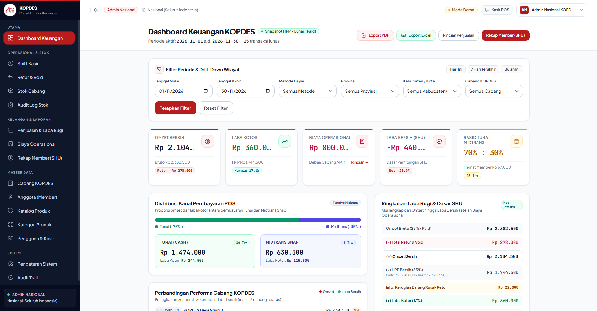
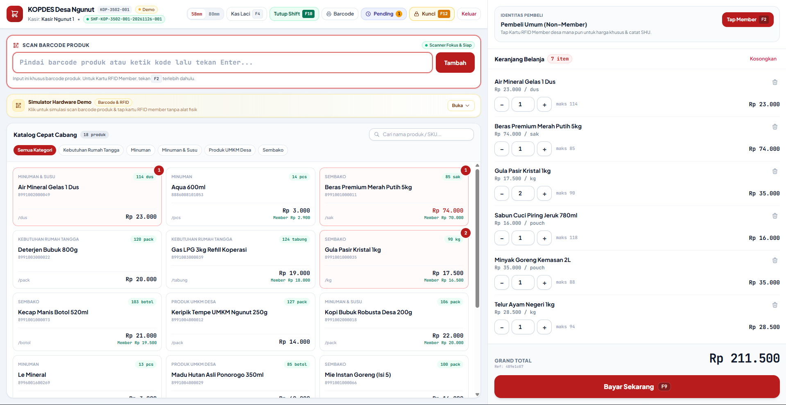
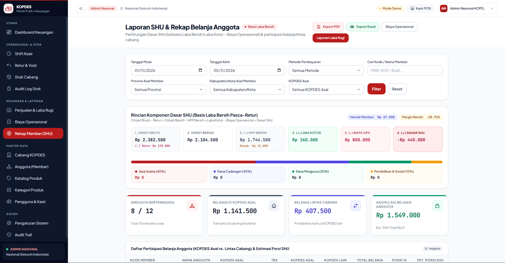
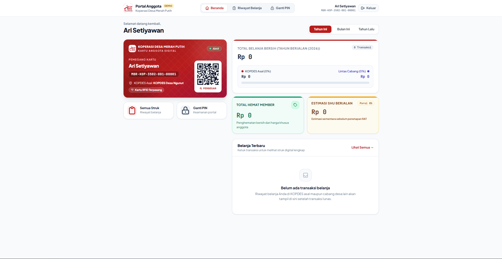
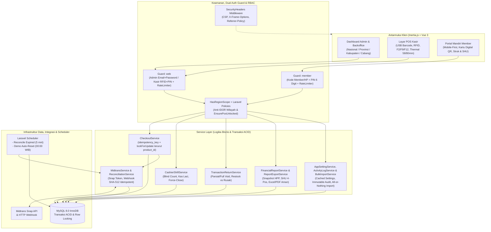

# KOPDES — Sistem Kasir & Manajemen Koperasi Desa Merah Putih

[](https://laravel.com)
[](https://vuejs.org)
[](https://inertiajs.com)
[](https://tailwindcss.com)
[](https://www.mysql.com)
[-16A34A?style=flat-square)]()
[-B91C1C?style=flat-square)](./SECURITY_AUDIT_REPORT.md)

Aplikasi web *full-stack* berskala nasional-hingga-desa untuk operasional **Koperasi Desa (KOPDES) Merah Putih**. Dirancang dengan arsitektur *multi-branch* hierarkis (**Nasional → Provinsi → Kabupaten → Cabang Desa**), Point of Sale (POS) terintegrasi USB Barcode Scanner & RFID Reader, pembayaran **Midtrans Snap**, manajemen Shift Kasir *Blind Count*, Retur/Void terpusat, Laporan Laba Rugi & SHU (Excel/PDF), Pengaturan Sistem Dinamis & Audit Trail, Onboarding Massal Excel/CSV, Cetak Barcode & Kartu Member, **Portal Mandiri Member** (*mobile-first*), serta **Mode Demo Portofolio** lengkap dengan Simulator Hardware dan auto-reset harian.

---

## Pratinjau Antarmuka (Screenshots)

| Dashboard Keuangan & Analitik Laba Rugi / SHU | Layar POS Kasir (Barcode/RFID & Midtrans Snap) |
| :---: | :---: |
|  |  |

| Laporan SHU, Biaya Operasional & Ekspor Excel/PDF | Portal Mandiri Member (Mobile-First & Kartu Digital QR) |
| :---: | :---: |
|  |  |

---

## Arsitektur Sistem



### Tech Stack Utama
- **Backend:** Laravel 13.x (PHP 8.3+), Eloquent ORM, Form Requests, Laravel Policies, Service Layer, Dual Auth Guard (`web` & `member`), `RateLimiter`, Scheduler.
- **Frontend:** Inertia.js 2 (`@inertiajs/vue3`), Vue 3 (`<script setup>` Composition API), Tailwind CSS 3 (`Design System KOPDES`), Ziggy (`route()`), `jsbarcode`, `qrcode`.
- **Database:** MySQL 8.0+ / MariaDB 10.6+ (InnoDB, `DB::transaction()` + `SELECT ... FOR UPDATE`, snapshot harga & HPP historis, tabel audit *append-only*).
- **Payment & Dokumen:** Midtrans Snap (Sandbox) + Webhook SHA-512, `phpoffice/phpspreadsheet` (Excel/CSV), `dompdf/dompdf` (PDF), cetak thermal 58mm/80mm & kartu ID-1 via `@media print`.

---

## Ringkasan Fitur (MVP s.d. Fase 3)

### Fase 1 — MVP Multi-Cabang, POS Kasir, Midtrans & Laporan (Milestone 1–5)
- **Aturan Mutlak 1 Desa = 1 KOPDES:** Penurunan otomatis `district_id`, `regency_id`, dan `province_id` di server dari referensi wilayah baku.
- **RBAC Hierarkis & Anti-IDOR (`HasRegionScope`):** Scoping ketat untuk `admin_nasional`, `admin_provinsi`, `admin_kabupaten`, `admin_cabang`, dan `kasir` (akses luar wilayah ditolak HTTP `403`).
- **Katalog Produk Global & Inventori Cabang:** Restock, Stock Adjustment (menolak nilai di bawah `reserved_qty`), dan audit log `stock_movements` bersifat *immutable*.
- **POS Kasir Berdukungan Hardware HID:** Auto-focus barcode scanner, modal RFID terisolasi (`F2`), shortcut Bayar (`F9`) & Kunci Layar (`F12`), Auto-Lock idle 15 menit (`EnsurePosUnlocked`), checkout atomik anti *double-click* (`idempotency_key` UUID v4 + `lockForUpdate()` terurut `product_id`), dan cetak struk thermal 58mm/80mm.
- **Portabilitas Member Lintas Desa:** Kartu RFID anggota aktif berlaku nasional di seluruh cabang KOPDES.
- **Midtrans Snap & Rekonsiliasi Terpusat:** Reservasi stok (`reserved_qty`) saat pending, pemotongan saat `paid`, pelepasan otomatis saat `expired`/`cancelled`, serta scheduler rekonsiliasi tiap 5 menit.
- **Biaya Operasional & Laporan Laba Rugi / SHU:** Agregasi berbasis snapshot HPP transaksi `paid` lengkap dengan ekspor **Excel (`.xlsx`)** dan **PDF**.

### Fase 2 — Harga Anggota, Shift Kasir *Blind Count* & Retur Terpusat (Milestone 6–9)
- **Harga Khusus Member (`member_price`):** Otomatis aktif saat kartu member di-tap di POS, tercatat sebagai snapshot permanen, dan menampilkan total penghematan di struk.
- **Manajemen Shift Kasir (*Blind Count*):** Wajib buka shift sebelum checkout, mutasi kas laci (`cash_in`/`cash_out`), tutup shift *Blind Count* tanpa bocoran ekspektasi kas, cetak struk tutup shift, serta fitur **Force-Close** oleh Admin.
- **Retur Parsial & Full Void:** Eksklusif Dashboard Admin (dalam batas hari retur), memisahkan item `restockable` (kembali ke stok & koreksi HPP) vs `damaged` (kerugian tanpa restock), terintegrasi penuh ke Laba Bersih & SHU.

### Fase 3 — Pengaturan Dinamis, Onboarding Massal, Portal Member & Mode Demo (Milestone 10–13)
- **Pengaturan Sistem Dinamis (`app_settings`):** Konfigurasi terpusat ber-cache oleh `admin_nasional` (nama lembaga, logo, footer & ukuran kertas struk, batas hari retur, dan 4 pos alokasi SHU wajib total `100%`).
- **Audit Trail Admin (`activity_logs`):** Log *append-only* dengan inspeksi diff nilai lama vs baru dan redaksi otomatis field sensitif (`password`, `pin_hash`).
- **Import Wilayah & Onboarding Massal Excel/CSV:** Command `php artisan kopdes:import-regions`, unduh template `.xlsx`, serta import **all-or-nothing** Produk, Stok Awal, dan Member (`card_uid` opsional).
- **Cetak Label Barcode & Kartu Member:** Stiker barcode SVG (`jsbarcode`, A4 Grid 3 kolom & Thermal 50x30mm) dan kartu member ID-1 (`85.6mm x 53.98mm`) dengan QR Code.
- **Portal Mandiri Member (`/member`):** Guard sesi terpisah (`member`), desain *mobile-first* dengan Kartu Anggota Digital + QR Code (dapat diperbesar via modal), KPI Belanja (KOPDES Asal vs Lintas Cabang), Total Hemat Member, Estimasi SHU Berjalan, Struk Digital, dan Ganti PIN Mandiri.
- **Mode Demo Portofolio & Simulator Hardware:** Terkunci di balik `APP_DEMO_MODE=true` (default `false`), mencakup Quick-Fill Login, Simulator Scan Barcode & Tap RFID di POS, serta `DemoDataSeeder` 3 bulan realistis.

---

## Security Hardening & Audit Keamanan

Aplikasi telah melalui audit keamanan menyeluruh terhadap seluruh lapisan backend & frontend dengan skor kesiapan **98 / 100** (**18/18 temuan `SEC-01`–`SEC-18` telah dipatch** dan diverifikasi otomatis pada `tests/Feature/SecurityAuditTest.php`). Rincian lengkap tersedia di [SECURITY_AUDIT_REPORT.md](./SECURITY_AUDIT_REPORT.md).

Sorotan pengamanan utama:
- **Midtrans Webhook Fail-Closed (`SEC-01`):** Menolak mutlak jika `MIDTRANS_SERVER_KEY` kosong, verifikasi `hash_equals()` SHA-512, validasi kesesuaian nominal `gross_amount`, idempotensi `lockForUpdate()`, dan rate limiting `throttle:120,1`.
- **Dokumen & Ekspor Anti-Eksploitasi (`SEC-02`, `SEC-03`):** DomPDF mengunci `isPhpEnabled = false` dan `isRemoteEnabled = false`; seluruh kolom teks ekspor `.xlsx` disanitasi dari *Excel Formula Injection* (`=`, `+`, `-`, `@`, `\t`, `\r`).
- **Proteksi Akun Demo & Isolasi Guard (`SEC-04`, `SEC-08`, `SEC-12`):** Mencegah sabotase akun demo (ubah email/password/PIN/hapus akun) saat `APP_DEMO_MODE=true`, memisahkan sesi `web` vs `member`, serta mengunci endpoint POS selama `pos_locked = true`.
- **Anti-XSS & HTTP Security Headers (`SEC-14`, `SEC-15`, `SEC-17`):** **Zero `v-html`** di seluruh komponen Vue 3 (QR Code dirender aman via ``, paginasi aman via `AppPagination.vue`), dilengkapi middleware `SecurityHeaders` (`X-Frame-Options`, `X-Content-Type-Options`, `Referrer-Policy`, `CSP`).
- **Rate Limiting & Anti-IDOR (`SEC-05`, `SEC-06`, `SEC-09`):** Perlindungan brute-force PIN (maks 5x gagal -> HTTP `429`), validasi ketat lintas cabang/wilayah pada seluruh endpoint CRUD, Inventory, Shift, Return, dan Bulk Import.

---

## Panduan Instalasi Lokal

### Prasyarat
- PHP **8.3+**, Composer 2.x
- Node.js **20+** & NPM
- MySQL **8.0+** / MariaDB **10.6+**

### Langkah Setup
```bash
# 1. Clone repositori & masuk folder proyek
git clone <url-repositori> kopdes
cd kopdes

# 2. Instal dependensi backend & frontend
composer install
npm install

# 3. Salin konfigurasi lingkungan & generate APP_KEY
cp .env.example .env
php artisan key:generate

# 4. Atur koneksi database MySQL pada .env (DB_DATABASE, DB_USERNAME, DB_PASSWORD)
#    Untuk mencoba Mode Demo Portofolio, tambahkan:
#    APP_DEMO_MODE=true

# 5. Buat symlink storage publik (untuk logo koperasi)
php artisan storage:link

# 6. Jalankan migrasi & build aset produksi Vite
php artisan migrate
npm run build

# 7. (Opsional) Seed data portofolio 3 bulan
php artisan db:seed --class=DemoDataSeeder

# 8. Jalankan server pengembangan
php artisan serve
```

### Scheduler & Auto-Reset Harian Live Demo
Daftarkan cron Laravel Scheduler di server (`* * * * * php artisan schedule:run >> /dev/null 2>&1`):
- **Setiap 5 menit:** `kopdes:reconcile-expired-transactions` (rekonsiliasi otomatis transaksi Midtrans kedaluwarsa & pelepasan `reserved_qty`).
- **Setiap hari pukul 00:00 WIB (`Asia/Jakarta`):** `migrate:fresh --seed --seeder=DemoDataSeeder --force` — **hanya aktif ketika `config('kopdes.demo_mode') === true`** agar lingkungan live demo selalu kembali bersih setiap hari tanpa risiko menyentuh database produksi.

---

## Daftar Akun Quick-Fill Demo

Setelah menjalankan `php artisan db:seed --class=DemoDataSeeder` (dengan `APP_DEMO_MODE=true`, tombol **Quick-Fill** juga tersedia langsung di masing-masing halaman login):

### 1. Dashboard Admin (`/login`)
| Peran | Email | Kata Sandi | Cakupan Wilayah |
| :--- | :--- | :--- | :--- |
| **Admin Nasional** | `admin.nasional@kopdes.id` | `password` | Seluruh Indonesia + Pengaturan Sistem |
| **Admin Provinsi** | `admin.jatim@kopdes.id` | `password` | Provinsi Jawa Timur |
| **Admin Kabupaten** | `admin.ponorogo@kopdes.id` | `password` | Kabupaten Ponorogo |
| **Admin Cabang (Ngunut)** | `admin.ngunut@kopdes.id` | `password` | KOPDES Desa Ngunut (`KOP-3502-001`) |
| **Admin Cabang (Cekok)** | `admin.cekok@kopdes.id` | `password` | KOPDES Desa Cekok (`KOP-3502-002`) |
| **Admin Cabang (Balerejo)** | `admin.balerejo@kopdes.id` | `password` | KOPDES Desa Balerejo (`KOP-3519-001`) |
| **Admin Cabang (Biting)** | `admin.biting@kopdes.id` | `password` | KOPDES Desa Biting (`KOP-3312-001`) |

### 2. Terminal Kasir POS (`/pos/login`)
| Kasir | Cabang KOPDES | UID Kartu RFID | PIN (6 Digit) |
| :--- | :--- | :--- | :--- |
| **Kasir Ngunut 1** | KOPDES Desa Ngunut | `0008493873` | `123456` |
| **Kasir Cekok 1** | KOPDES Desa Cekok | `0008305215` | `123456` |
| **Kasir Balerejo 1** | KOPDES Desa Balerejo | `0008510003` | `123456` |
| **Kasir Biting 1** | KOPDES Desa Biting | `0008510004` | `123456` |

### 3. Portal Mandiri Member (`/member/login`)
| Anggota | KOPDES Asal | Kode Member | Nomor HP | UID RFID | PIN |
| :--- | :--- | :--- | :--- | :--- | :--- |
| **Ari Setiyawan** | KOPDES Desa Ngunut | `MBR-KOP-3502-001-00001` | `081234567890` | `0009329774` | `123456` |
| **Cintya Bella** | KOPDES Desa Cekok | `MBR-KOP-3502-002-00001` | `081234567891` | `0009434179` | `123456` |
| **Siti Aminah** *(Belum Binding RFID)* | KOPDES Desa Ngunut | `MBR-KOP-3502-001-00003` | `081234560103` | *(kosong)* | `123456` |

---

## CI/CD & Pengujian Otomatis

Workflow GitHub Actions [`.github/workflows/ci.yml`](./.github/workflows/ci.yml) berjalan otomatis pada setiap `push` dan `pull_request` ke branch `main` menggunakan **PHP 8.3**, **Node.js 20**, dan service **MySQL 8.0** untuk memverifikasi build produksi Vite dan seluruh test suite.

```bash
# Menjalankan seluruh test suite (106 tests / 1.308 assertions)
php artisan test

# Memeriksa daftar jadwal Scheduler aktif
php artisan schedule:list

# Menjalankan build produksi Vite
npm run build
```

---

## Lisensi

Proyek ini dikembangkan sebagai portofolio implementasi sistem koperasi desa modern (*full-stack*) berbasis Laravel 13, Inertia.js, Vue 3, dan Tailwind CSS.
